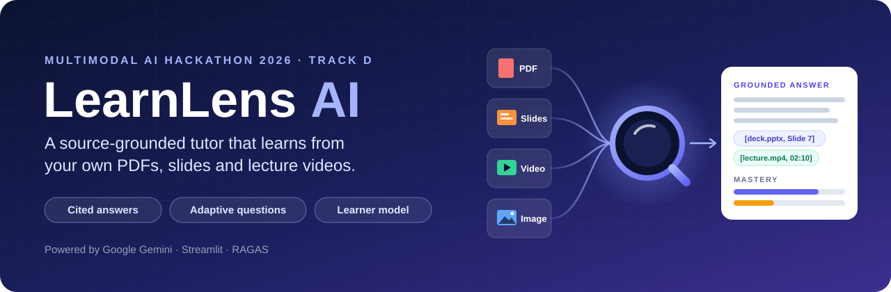
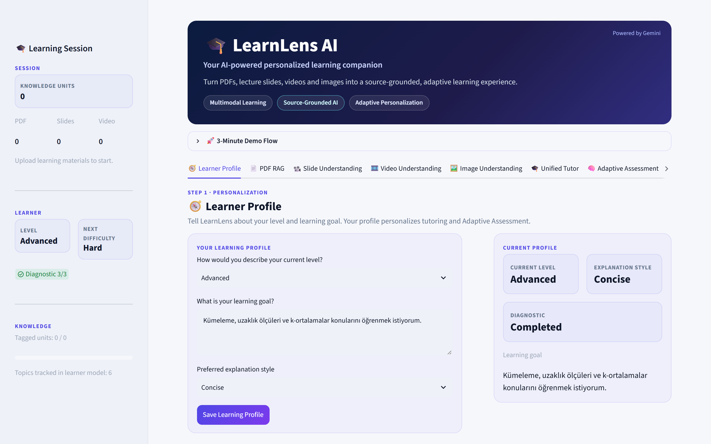
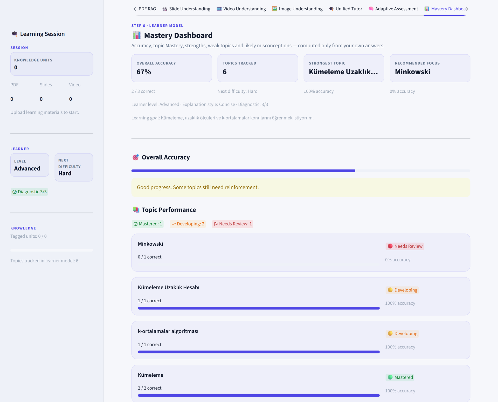
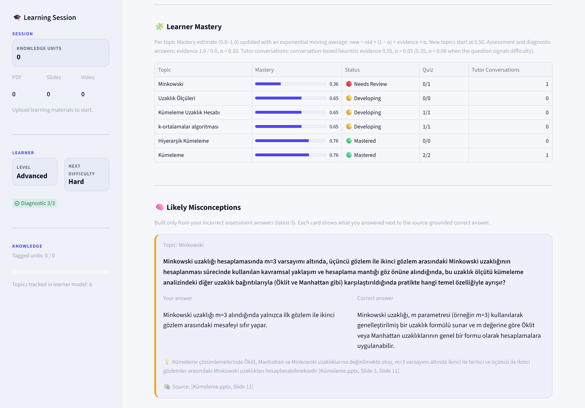
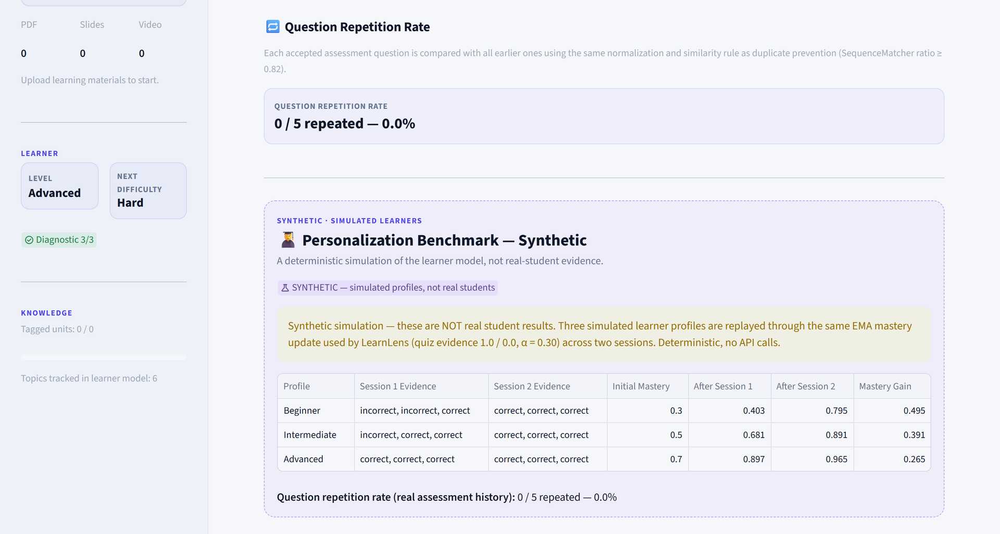
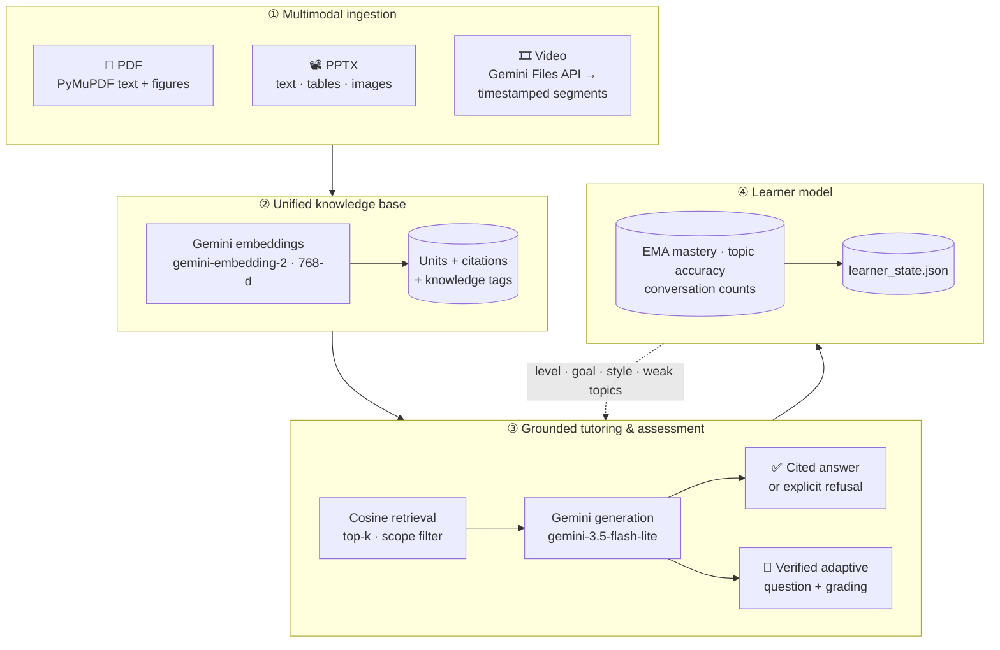

<p align="center">
  
</p>

<p align="center">
  <b>A multimodal, source-grounded AI tutor that learns from your own course material — PDFs, slides and lecture videos — adapts its questions to you, and refuses to make things up.</b>
</p>

<p align="center">
  <br>
  <i>Track D: Personalized Tutoring &amp; Adaptive Learning</i>
</p>

<p align="center">
  
  
  
  
  
</p>

<p align="center">
  <a href="#screenshots">Screenshots</a> ·
  <a href="#track-d-alignment">Track D alignment</a> ·
  <a href="#architecture">Architecture</a> ·
  <a href="#installation">Installation</a> ·
  <a href="#demo-flow">Demo flow</a> ·
  <a href="TRACK_D_STATUS.md">Track D status</a> ·
  <a href="SUBMISSION.md">Submission summary</a>
</p>

---

## Problem

Students study from a mix of lecture slides, PDF notes and recorded lectures.
General-purpose chatbots answer from the open internet rather than from *this*
course, they hallucinate confidently, they do not cite where an answer came from,
and they do not know what a particular student already understands. Practice
questions are generic, repeat themselves, and do not get harder or easier as the
student improves.

## Solution

LearnLens AI turns a student's own material into one searchable multimodal
knowledge base and builds a tutor around it:

- **Grounded answers** with exact citations — `[file.pdf, Page 3]`,
  `[deck.pptx, Slide 7]`, `[lecture.mp4, 02:10 - 03:05]`.
- **Honest refusal** when the material does not contain the answer:
  *"Bu bilgi yüklenen ders materyallerinde bulunamadı."*
- **Adaptive, verified assessments** (MCQ, short answer, numerical) whose
  difficulty follows the student's performance.
- **A learner model** that tracks mastery per topic from quizzes, the diagnostic
  and tutoring conversations, and uses it to personalize explanations.
- **Built-in evaluation**: RAGAS metrics, a team-built benchmark, refusal accuracy,
  citation matching and question repetition rate.

## Why LearnLens AI is different

- **One knowledge base for all modalities.** PDF pages (including embedded
  figures), slides (text, tables, images) and timestamped video segments are
  retrieved together, so one answer can cite a slide and a video timestamp.
- **Grounding is enforced and measured.** Strict prompts, citation preservation,
  a fixed refusal sentence, and a benchmark that checks refusals and expected
  sources.
- **Questions are checked twice.** A second Gemini pass verifies every generated
  question against the source and rejects anything ambiguous, unsupported or not
  self-contained (including questions that would need a figure the student
  cannot see).
- **Transparent learner model.** A simple exponential moving average per topic,
  documented constants, no black box.
- **Quota-aware.** Embeddings and knowledge tags are cached, tagging is batched
  and need-based, and the benchmark stops cleanly on API quota errors.

## Screenshots

<table>
  <tr>
    <td width="50%"></td>
    <td width="50%"></td>
  </tr>
  <tr>
    <td align="center"><b>🧭 Learner Profile</b> — level, goal, explanation style and the cold-start diagnostic</td>
    <td align="center"><b>📊 Mastery Dashboard</b> — accuracy, strongest topic, recommended focus</td>
  </tr>
  <tr>
    <td width="50%"></td>
    <td width="50%"></td>
  </tr>
  <tr>
    <td align="center"><b>🧩 EMA learner model & 🧠 Likely Misconceptions</b> — built only from the student's own wrong answers, with source citation</td>
    <td align="center"><b>🧪 Evaluation</b> — question repetition rate and the clearly labelled synthetic personalization benchmark</td>
  </tr>
</table>

## Track D alignment

| Track D requirement | LearnLens AI |
|---|---|
| Multimodal content understanding | PDF text + figures, PPTX text/tables/images, video segments, image Q&A |
| Knowledge structure per content unit | Topic, subtopic, key concepts, prerequisites per unit (batched Gemini tagging, cached) |
| Source-grounded tutoring | Retrieval-augmented answers with page / slide / timestamp citations and refusal |
| Adaptive assessment | MCQ / short answer / numerical, Easy ↔ Medium ↔ Hard adaptation, semantic grading |
| Question quality | Second-pass verification, self-containment, duplicate prevention, repetition rate |
| Learner model updated after quizzes **and** conversations | EMA mastery per topic + topic accuracy + conversation counts |
| Weak topics and misconceptions | Recommended focus + Likely Misconceptions from the student's own wrong answers |
| Cold start | 3-question diagnostic (Easy → Medium → Hard) |
| Personalization | Level, goal, explanation style and weak topics injected into the tutor |
| Persistence | `learner_state.json` across sessions |
| Evaluation | RAGAS (4 metrics), batch benchmark, refusal accuracy, source match, repetition rate, **synthetic** multi-session profile simulation |

A detailed requirement-by-requirement status is in
[TRACK_D_STATUS.md](TRACK_D_STATUS.md).

## Main features

| Tab | What it does |
|---|---|
| 🧭 Learner Profile | Level, learning goal, explanation style; 3-question starting-level diagnostic |
| 📄 PDF RAG | Upload PDFs; page-level retrieval with figures; cited answers |
| 📽️ Slide Understanding | Upload PPTX; slide text, tables and embedded images; cited answers |
| 🎞️ Video Understanding | Upload a lecture video; Gemini builds timestamped knowledge segments |
| 🖼️ Image Understanding | Ask questions about a diagram, photo or screenshot |
| 🎓 Unified Tutor | Personalized, grounded answers across all uploaded material; Knowledge Structure view |
| 🧠 Adaptive Assessment | Verified MCQ / short / numerical questions with adaptive difficulty |
| 📊 Mastery Dashboard | Accuracy, EMA topic mastery, strongest / weakest topic, likely misconceptions |
| 🧪 Evaluation | RAGAS single question, benchmark test set, repetition rate, synthetic personalization benchmark |

## Multimodal capabilities

| Input | Processing | Citation |
|---|---|---|
| PDF | PyMuPDF text, chunked per page (1200 chars, 200 overlap); up to 2 embedded figures per page, sent to Gemini when the page is retrieved | `[file.pdf, Page N]` |
| PowerPoint | python-pptx text frames, tables, embedded pictures (up to 2 per retrieved slide sent to Gemini) | `[file.pptx, Slide N]` |
| Video | Gemini Files API; Gemini segments the lecture into timestamped topic segments that are embedded like text | `[video.mp4, mm:ss - mm:ss]` |
| Image | Direct visual question answering with Gemini | — |

## Architecture



Images are answered directly with Gemini vision in the 🖼️ Image Understanding tab.

Everything runs in one Streamlit app (`app.py`). Gemini is the only AI provider.

## How source-grounded RAG works

1. Each PDF chunk, slide and video segment becomes a **knowledge unit** with a
   fixed citation string.
2. The question is embedded and the top units are retrieved by cosine similarity
   (optionally limited to PDF / Slides / Video).
3. Gemini receives only those units (plus up to 2 images per retrieved page or
   slide) and strict rules: answer only from the material, keep the exact
   citation for every important claim, and otherwise reply
   *"Bu bilgi yüklenen ders materyallerinde bulunamadı."*
4. The UI shows the answer, the sources used (with similarity scores and topic),
   and marks refusals explicitly. Refusal detection is deterministic and ignores
   case, Turkish character variants, Markdown and punctuation.

## Adaptive assessment approach

- **Generation:** source units are sampled (or retrieved for a chosen topic); Gemini
  writes one question with a required exact citation, varying the "question focus"
  each attempt. PDF figures of those pages help the model understand the material.
- **Checks before acceptance:** valid JSON, exact allowed citation, 4 options with
  the key among them (MCQ), not similar to the last 15 questions (normalized
  `SequenceMatcher` ≥ 0.82), no references to hidden visuals ("the figure",
  "şekildeki", "slaytta" …).
- **Verification:** a second Gemini pass (with the same images) must confirm the
  question is answerable from the material alone, correct, unambiguous and fully
  self-contained. Otherwise another question is generated (up to 8 attempts).
- **Adaptation:** 2 correct answers in a row → harder; 1 wrong answer → easier.
- **Grading:** MCQ by exact option; short and numerical answers semantically by
  Gemini (equivalent numerical forms accepted).

## Learner model (EMA)

For every topic, LearnLens keeps a mastery estimate between 0 and 1:

```
new_mastery = old_mastery × (1 − α) + evidence × α        (new topic starts at 0.50)
```

| Evidence source | evidence | α |
|---|---|---|
| Assessment or diagnostic answer — correct / wrong | 1.0 / 0.0 | 0.30 |
| Tutor conversation (heuristic) | 0.55 | 0.05 |
| Tutor conversation with an explicit difficulty signal ("anlamadım", "zorlanıyorum", "I'm confused" …) | 0.35 | 0.08 |

Conversation evidence is deliberately weak: asking about a topic is not proof of
learning. Off-material (refused) questions do not change the model.

**Canonical topics:** a question's topic is the knowledge tag of the unit it cites,
and tutor conversations use the tag of the top retrieved unit, so quizzes,
mastery, conversation counts and the dashboard refer to the same topic. Labels
that differ only in case or whitespace are unified; different topics are never
merged.

## Personalization

The tutor prompt includes the learner's **level** (Beginner / Intermediate /
Advanced), **learning goal**, **explanation style** (Concise / Balanced /
Detailed) and up to three **weak topics** (topic accuracy < 70 % or EMA mastery
< 0.50). Each level and style maps to explicit writing instructions. Grounding
rules always take precedence: personalization may change *how* something is
explained, never *what* the material says.

## Diagnostic / cold start

New learners take a 3-question diagnostic (Easy → Medium → Hard MCQs generated and
verified from their own material, focused on their stated goal):

| Score | Estimated level | Starting difficulty |
|---|---|---|
| 0–1 | Beginner | Easy |
| 2 | Intermediate | Medium |
| 3 | Advanced | Hard |

Each diagnostic answer also updates EMA mastery for its topic.

## Evaluation methodology

All evaluation lives in the **🧪 Evaluation** tab and runs against the material
you upload:

- **Single-question RAGAS evaluation** — your question + reference answer.
- **Benchmark test set** — [`evaluation_testset.json`](evaluation_testset.json),
  team-built for a clustering lecture deck (*Kümeleme.pptx*): 5 in-material
  questions with reference answers and expected slide citations, plus 1
  off-material question that must be refused.
  - *Quick Benchmark* (default, 3 cases, quota-safe) or *Full Benchmark* (6 cases).
  - Per case: RAGAS metrics, refusal correctness, expected-source match
    (citation found in the retrieved sources or in the answer).
  - Summary: average of each RAGAS metric, **Refusal Accuracy**,
    **Citation / Expected Source Match**; exported to `evaluation_results.json`
    and `evaluation_results.csv`.
  - API quota errors stop the run cleanly; with no successful case, no scores
    are shown.
- **Question Repetition Rate** — share of accepted assessment questions that are
  similar to an earlier one (same rule as duplicate prevention).
- **Personalization Benchmark (synthetic)** — three *simulated* learner profiles
  replayed through the real EMA update over two sessions. Deterministic, no API
  calls, and clearly labelled as simulation — **not** real-student evidence.

We do not publish fixed benchmark scores here: they depend on the uploaded
material, the Gemini model and API quota, and RAGAS scores vary between runs.
Run the benchmark yourself to reproduce them.

## RAGAS metrics

| Metric | Question it answers |
|---|---|
| **Faithfulness** | Are the answer's claims supported by the retrieved context? |
| **Answer Relevancy** | Does the answer address the question? |
| **Context Precision** | Are the retrieved units relevant (and ranked well) for the reference answer? |
| **Context Recall** | Does the retrieved context contain what the reference answer needs? |

RAGAS 0.4.3 uses Gemini as judge through Gemini's OpenAI-compatible endpoint
(the `openai` Python client, no OpenAI account), and a fixed 768-dimensional Gemini
embedding wrapper so that dimensions always match.

## Known limitations

- The learner model is a transparent heuristic (EMA), not a validated
  psychometric model; conversation evidence in particular is a heuristic.
- No study with real students has been run; the personalization benchmark is
  synthetic.
- Canonical topics rely on knowledge tags; without tags the generator's
  free-text topic is used. Tag topics are broad sections.
- Gemini free-tier quotas are small. RAGAS makes many calls per case, so the Full
  Benchmark can hit HTTP 429; Quick Benchmark is the default.
- The benchmark is small (6 cases, one lecture deck); expected-source matching
  assumes the deck is uploaded as `Kümeleme.pptx`.
- RAGAS uses the same model family as the tutor as its judge (possible
  self-evaluation bias); scores vary between runs.
- Refusal detection is phrase-based (deterministic, no extra LLM call).
- Assessment questions are text-only: questions that would need a figure are
  rejected instead of displayed with the figure.
- Uploaded material lives in the browser session and must be re-uploaded after a
  refresh; learner progress persists in `learner_state.json`.
- Single-user, local JSON storage; no authentication.

## Tech stack

- **Python 3.10+**, **Streamlit** (UI)
- **Google Gemini** via the `google-genai` SDK
  - `gemini-3.5-flash-lite` — answers, question generation and verification,
    grading, video segmentation, knowledge tagging, RAGAS judge
  - `gemini-embedding-2` (768-d) — retrieval embeddings
  - Gemini Files API — video upload and understanding
  - Gemini OpenAI-compatible endpoint — RAGAS judge via the `openai` client
- **PyMuPDF** (PDF text and figures), **python-pptx** (slides), **NumPy**
  (vector search)
- **RAGAS 0.4.3** (evaluation), **python-dotenv**

## Installation

Requirements: Python 3.10 or newer and a Gemini API key
(free at [Google AI Studio](https://aistudio.google.com/apikey)).

```bash
git clone https://github.com/betulaltunyuva/learnlens-ai.git LearnLens-AI
cd LearnLens-AI

python -m venv venv
# Windows
venv\Scripts\activate
# macOS / Linux
source venv/bin/activate

pip install -r requirements.txt
```

## Environment setup

```bash
# Windows
copy .env.example .env
# macOS / Linux
cp .env.example .env
```

Edit `.env` and set your key:

```
GEMINI_API_KEY=your_api_key_here
```

`.env` is git-ignored. Never commit a real key.

## Run

```bash
streamlit run app.py
```

The app opens at http://localhost:8501. Local files created while running
(all git-ignored): `learner_state.json`, `knowledge_tags.json`,
`evaluation_results.json`, `evaluation_results.csv`.

## Demo flow

1. **🧭 Learner Profile** — choose a level, enter a goal, pick a style, *Save*.
2. **📽️ Slide Understanding** — upload a lecture deck (for the benchmark:
   `Kümeleme.pptx`); optionally add a PDF and a short video.
3. **🧭 Learner Profile → Start Diagnostic** — answer 3 questions; the level and
   starting difficulty update (see the sidebar).
4. **🎓 Unified Tutor** — ask *"Minkowski uzaklığı nedir?"* → cited answer and a
   learner-model update; then ask *"Yapay sinir ağlarında backpropagation
   algoritması nedir?"* → refusal. Open *🧩 Knowledge Structure*.
5. **🧠 Adaptive Assessment** — answer a few questions; watch *Next Difficulty*.
6. **📊 Mastery Dashboard** — topic accuracy, EMA mastery, recommended focus,
   Likely Misconceptions.
7. **🧪 Evaluation** — single RAGAS question, then *Run Benchmark* (Quick); show
   the repetition rate and the synthetic personalization table.

## Repository structure

```
LearnLens-AI/
├── app.py                   # Streamlit application (all features)
├── .streamlit/config.toml   # UI theme (colors, font)
├── requirements.txt         # Python dependencies
├── .env.example             # Template for GEMINI_API_KEY
├── .gitignore
├── evaluation_testset.json  # Team-built benchmark test set
├── assets/
│   ├── banner.svg           # README banner
│   └── screenshots/         # README screenshots
├── LICENSE                  # MIT
├── README.md
├── SUBMISSION.md            # Devpost-ready project summary
└── TRACK_D_STATUS.md        # Requirement-by-requirement implementation status
```

## Responsible AI and grounding

- LearnLens answers only from material the learner uploaded and cites the exact
  page, slide or timestamp so every claim can be checked.
- When the material does not contain the answer, it says so instead of guessing.
- Assessment questions are verified against the source before they are shown.
- Learner-model rules are simple and documented; misconceptions are shown only
  from the student's own wrong answers, never invented.
- Simulated results are labelled as simulated; no real-student outcomes are
  claimed.
- Learner data stays local in a JSON file. Uploaded material is sent to the
  Gemini API for processing, subject to Google's API terms. Do not upload
  material you are not allowed to share with that service.
- LearnLens supports learning; it does not replace teachers or official course
  information.

## AI-assisted development disclosure

AI coding assistants including ChatGPT and Claude Code were used during
development for code review, debugging and implementation assistance. All
generated code was reviewed, integrated and tested by the project author.

At runtime, the application itself uses Google Gemini models as described in the
tech stack.

## License

Released under the [MIT License](LICENSE).

## Author

**Betül Altunyuva** — [GitHub](https://github.com/betulaltunyuva) ·
[Devpost](https://devpost.com/betulaltunyuva)
